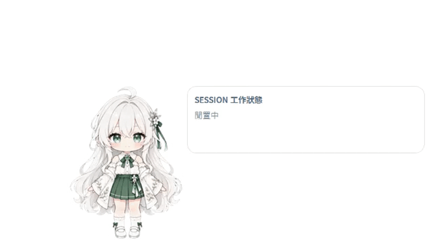

# Desktop Pet

Desktop Pet 是一款給 Codex 使用者的 Windows 桌面夥伴。它會常駐在桌面最上層，用動畫呈現 Codex 正在思考、執行工具、等待授權或已完成工作，也會短暫顯示 Codex 的最後回覆。


## 主要功能

- 一眼看出 Codex 目前是思考中、工作中、等待回覆，還是已完成。
- 同時追蹤多個 Codex 工作，點一下桌寵即可展開工作清單。
- 工作完成時顯示回覆摘要與檔案變更統計。
- 可調整角色大小、動畫速度、工作清單位置與透明度。
- 所有事件只透過本機連線傳送，不需要額外的雲端服務。

## 系統需求

- Windows
- Python 3.14 以上
- [uv](https://docs.astral.sh/uv/)
- Codex（只有接收 Codex 狀態時才需要）

## 快速開始

在專案根目錄執行：

```powershell
uv sync
uv run desktop-pet
```

桌寵現在已可獨立使用。若要讓它顯示 Codex 的即時狀態，請繼續完成下一節的 Hook 設定。

> 已建立 `.venv` 時，也可以執行 `.venv\Scripts\python.exe main.py`。

## 連接 Codex

1. 啟動桌寵。
2. 在桌寵上按右鍵，選擇「設定」。
3. 切換到「Hook 設定」，按下「設定／更新 Hook」。
4. 回到 Codex 輸入 `/hooks`，審閱並信任新增或更新的 Hook。

設定完成後，Codex 開始工作、執行工具、要求授權及結束回合時，桌寵會自動切換狀態。若偏好命令列，也可以執行：

```powershell
uv run python install_codex_hooks.py
```

安裝程式會保留既有 Hook；需要修改現有設定時，會先在同一目錄建立 `hooks.json.bak.desktop_pet_v2` 備份。

## 日常操作

| 操作 | 功能 |
| --- | --- |
| 點一下桌寵 | 顯示或收起 Codex 工作清單 |
| 按住滑鼠左鍵拖曳 | 移動桌寵 |
| 在桌寵上按右鍵 | 開啟設定、重播開機動畫或結束程式 |
| 開場動畫播放時點一下 | 跳過動畫，直接顯示桌寵 |

設定面板包含三個頁面：

- **設定**：調整角色大小、動畫速度、工作清單位置與透明度，並決定下次啟動時是否播放開場動畫。
- **Hook 測試**：不必真的執行 Codex 工作，也能預覽各種狀態與完成回覆。
- **Hook 設定**：安裝或更新 Codex Hook。

所有偏好都會自動保存。關閉設定面板不會結束桌寵；若要退出，請從右鍵選單選擇「Exit」，或在設定頁按「停止運行」。



## 狀態說明

| 畫面狀態 | 代表意義 |
| --- | --- |
| Idle | 目前沒有進行中的工作 |
| Thinking | Codex 正在思考或準備下一步 |
| Working | Codex 正在執行工具 |
| Asking | Codex 正等待你的授權或回覆 |
| Success | 工作已完成 |
| Failed | 工作失敗 |
| Cancelled | 工作已中斷 |

完成工作時，桌寵會顯示回覆的前 100 個字，並在六秒後自動收起。若回覆內含檔案變更統計，也會一併顯示。

## 常見問題

### 桌寵有出現，但沒有跟著 Codex 切換狀態

請確認已在「Hook 設定」完成安裝，並在 Codex 的 `/hooks` 頁面信任該 Hook。你也可以先到「Hook 測試」確認桌寵本身能正常切換動畫。

### 關閉設定面板後，桌寵仍在執行

這是正常行為。設定面板只負責調整選項；請使用右鍵選單的「Exit」或設定頁的「停止運行」結束桌寵。

### 不想每次啟動都播放開場動畫

在「設定」頁關閉「啟動時播放開場動畫」。之後仍可從右鍵選單手動重播。

## 開發與維護

事件對應、動畫播放規則、專案結構與驗證方式已整理至 [內部開發文件](docs/INTERNALS.md)。
